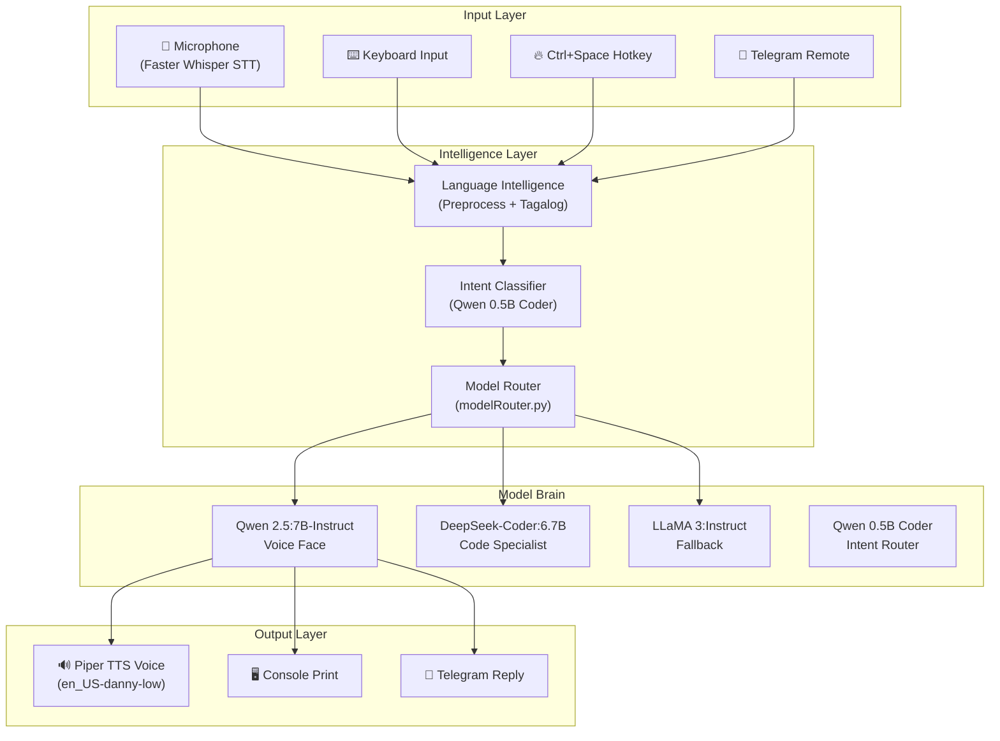
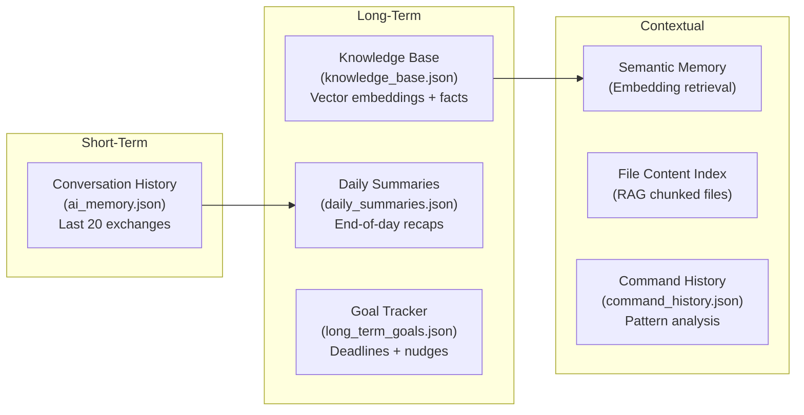

# JARVIS AI Assistant — Full System Report

> **Version:** JARVIS 6.0 Pro  
> **Creator:** Mr. Kirby Paladan  
> **Codebase:** `c:\Users\user\OneDrive\Documents\MyAiOfflineProject`  
> **Core Engine:** [tts.py](file:///c:/Users/user/OneDrive/Documents/MyAiOfflineProject/tts.py) (3,164 lines / 140 KB)  
> **Runtime:** 100% Offline via Ollama (`localhost:11434`)  
> **Platform:** Windows — Python 3.x

---

## 1. System Architecture Overview



---

## 2. Model Brain (Tier 0)

> **Hardware Rule:** One model per request always. Escalation only when intent classifier confidence is below 70%. Never parallel by default.

| Role | Model | Purpose |
|------|-------|---------|
| **Voice Face** | `qwen2.5:7b-instruct` | The only model that speaks. All responses pass through Qwen. |
| **Intent Router** | `Qwen2.5-Coder-0.5B-Instruct:Q8_0` | Classifies every input into one of 13 intents. Never speaks directly. |
| **Code Specialist** | `deepseek-coder:6.7b` | Generates code silently. Output is wrapped by Qwen into natural speech. |
| **Fallback** | `llama3:instruct` | Activated only when intent confidence < 70%. |
| **Embedding** | `nomic-embed-text` | Dedicated embedding model for vector memory / RAG. |
| **Vision (Fast)** | `llava:7b` | Screen understanding and camera vision. |
| **Vision (Detail)** | `llava:13b` | High-detail visual analysis. |
| **Multi-Agent Planner** | `phi3:mini` | Decomposes complex multi-part tasks into subtasks. |

### Model Routing Logic — [modelRouter.py](file:///c:/Users/user/OneDrive/Documents/MyAiOfflineProject/modules/modelRouter.py)

1. Intent classifier returns `(intent, confidence)` for every input.
2. If `confidence < 0.70` → escalate to `llama3:instruct`.
3. If `intent == "code"` or `"codebase"` → route to `deepseek-coder:6.7b`.
4. All other intents → route to `qwen2.5:7b-instruct`.
5. Health check with 60s TTL cache; retries 3× on startup.

### Code Containment Layer

When a code question is detected:
1. **DeepSeek** generates the raw code/explanation silently.
2. Raw output is printed to console for reference.
3. **Qwen** wraps the technical output into natural spoken language.
4. Only Qwen's wrapped version is spoken aloud.

---

## 3. Centralized Configuration — [config.py](file:///c:/Users/user/OneDrive/Documents/MyAiOfflineProject/config.py)

All 90+ settings in one file (283 lines). Key sections:

| Section | Notable Settings |
|---------|-----------------|
| **Models** | `VOICE_FACE_MODEL`, `INTENT_MODEL`, `CODE_MODEL`, `FALLBACK_MODEL`, `CONFIDENCE_THRESHOLD = 0.70` |
| **Audio** | `VOICE = en_US-danny-low.onnx`, `SAMPLE_RATE = 16000`, `COMMAND_TIMEOUT = 8s` |
| **Memory** | `MAX_HISTORY = 20`, `CONTEXT_RESTART_MSGS = 5`, `EMBEDDING_MODEL = nomic-embed-text` |
| **Vector Memory** | `MAX_VECTOR_RESULTS = 3`, `VECTOR_THRESHOLD = 0.75` |
| **VAD** | `VAD_AGGRESSIVENESS = 2`, `VAD_END_OF_SPEECH_MS = 1200`, `VAD_MAX_UTTERANCE_SECS = 30` |
| **Wake Word** | `OWW_WAKE_WORD_MODEL = "hey_jarvis"`, `OWW_DETECTION_THRESHOLD = 0.5` |
| **Privacy** | `PRIVACY_REMINDER_MINS = 10`, `ENCRYPT_MEMORY = False` |
| **Approval Gate** | `delete, uninstall, git_push, git_force, run_script, format_drive, organize_files, clear_history` |
| **Cache** | `RESPONSE_CACHE_TTL = 300s`, `ENABLE_RESPONSE_CACHE = False` (testing) |
| **Mic Calibration** | `MIC_CALIBRATION_SECS = 2`, `MIC_ENERGY_FLOOR = 150` |
| **Body Awareness** | `BATTERY_WARN_LOW = 20%`, `CPU_TEMP_THRESHOLD = 85°C`, `DISK_FREE_WARN_GB = 5` |
| **Spotify** | Client ID, Secret, Redirect URI configured for local OAuth |
| **Telegram** | Bot token + allowed user IDs for remote access |
| **Browser Agent** | Playwright-based, `BROWSER_HEADLESS = False`, 15s timeout |
| **File Index (RAG)** | Chunking at 800 chars, 100 overlap, supports `.txt .md .py .js .json .pdf .docx` and more |

---

## 4. Intent Classification System

### 13 Recognized Intents

| Intent | Description |
|--------|-------------|
| `system` | Volume, brightness, open/launch apps, uninstall |
| `vision` | Camera or screen visual queries |
| `music` | Spotify playback control |
| `tasks` | Create, complete, list to-do items |
| `files` | Search, locate, open files and folders |
| `notes` | Save notes, write to notepad, screen scan |
| `screenshot` | Take a screenshot |
| `internet` | Web search, weather, news, Wikipedia |
| `monitor` | PC specs, WiFi, system status, kill processes |
| `capabilities` | "What can you do?" self-knowledge |
| `code` | Programming/code generation questions |
| `codebase` | Self-awareness of own source code |
| `chat` | General conversation (default) |

### Classification Pipeline — [detect_intent()](file:///c:/Users/user/OneDrive/Documents/MyAiOfflineProject/tts.py#L1365-L1506)

1. **Greeting/casual override** — exact match set of ~30 phrases → `chat | 1.0`
2. **Short input override** — ≤ 3 words with no action keywords → `chat | 0.85`
3. **11 keyword override layers** (files, window, monitor, system, codebase, clock/time, tasks, clipboard/timer, notes, capabilities, internet)
4. **AI fallback** — queries `Qwen 0.5B Coder` with structured prompt → `intent | confidence`
5. **Escalation** — if confidence < 70%, re-classifies with `llama3:instruct`

---

## 5. All Modules (30+ Files)

### Tier 0 — Model Brain

| Module | File | Description |
|--------|------|-------------|
| **Model Router** | [modelRouter.py](file:///c:/Users/user/OneDrive/Documents/MyAiOfflineProject/modules/modelRouter.py) | Routes requests to correct model based on intent + confidence. Health checks with TTL cache. |

---

### Tier 1 — Body Awareness

| Module | File | Description |
|--------|------|-------------|
| **Body Awareness** | [bodyAwareness.py](file:///c:/Users/user/OneDrive/Documents/MyAiOfflineProject/modules/bodyAwareness.py) (19 KB) | Battery monitoring (20% warning, 10% critical), CPU temperature alerts (>85°C), disk space warnings (<5 GB), full diagnostics report. Event-driven, not polling. |
| **System Monitor** | [systemMonitor.py](file:///c:/Users/user/OneDrive/Documents/MyAiOfflineProject/modules/systemMonitor.py) (23 KB) | Full PC specs, WiFi info/password, internet speed test, running apps list, kill processes, hardware brand/model detection. |

---

### Tier 2 — Language Intelligence

| Module | File | Description |
|--------|------|-------------|
| **Language Intelligence** | [languageIntelligence.py](file:///c:/Users/user/OneDrive/Documents/MyAiOfflineProject/modules/languageIntelligence.py) (9 KB) | Input preprocessing: phonetic mishear corrections (167 entries), Tagalog-English translation (43 mappings), custom voice shorthands, pronoun resolution from conversation context, partial/ambiguous input clarification, tone detection. |

---

### Tier 3 — Autonomous Execution

| Module | File | Description |
|--------|------|-------------|
| **Autonomous Execution** | [autonomousExecution.py](file:///c:/Users/user/OneDrive/Documents/MyAiOfflineProject/modules/autonomousExecution.py) (24 KB) | Voice macro chains, approval gate for destructive actions (delete/uninstall/git push/format), multi-language code execution (Python/JS/TS/Go/Ruby/Perl/C/C++/C#/Bash/PowerShell), Git voice control (commit/push/pull/status), Downloads folder organizer, clipboard code watcher, scheduled automations. |

---

### Tier 4 — Deep Memory

| Module | File | Description |
|--------|------|-------------|
| **Deep Memory** | [deepMemory.py](file:///c:/Users/user/OneDrive/Documents/MyAiOfflineProject/modules/deepMemory.py) (14 KB) | Vector memory with cosine similarity (nomic-embed-text), TF-IDF fallback with character n-grams, daily session summaries, knowledge base wiki, long-term goal tracker with weekly nudges, work pattern analysis (peak productivity hours), emotional state inference (frustrated/tired/pleased/neutral). |
| **Semantic Memory** | [semanticMemory.py](file:///c:/Users/user/OneDrive/Documents/MyAiOfflineProject/modules/semanticMemory.py) (3 KB) | Save and recall semantic facts with embedding-based retrieval. |
| **Command History** | [commandHistory.py](file:///c:/Users/user/OneDrive/Documents/MyAiOfflineProject/modules/commandHistory.py) (4 KB) | Logs every command with timestamps, analyzes user patterns, suggests command shortcuts. |

---

### Tier 5 — Personality & Security

| Module | File | Description |
|--------|------|-------------|
| **Personality Engine** | [personalityEngine.py](file:///c:/Users/user/OneDrive/Documents/MyAiOfflineProject/modules/personalityEngine.py) (3 KB) | Adaptive personality: tone (helpful/polite/loyal), humor level (0.0–1.0), speech rhythm (eloquent/concise). Auto-adjusts based on inferred user emotion — gentler when frustrated, quieter when tired, warmer when pleased. |
| **Self-Repair** | [selfRepair.py](file:///c:/Users/user/OneDrive/Documents/MyAiOfflineProject/modules/selfRepair.py) (12 KB) | Module watchdog (restarts crashed modules), resource guardian (RAM/CPU overload protection at 90%/95%), crash journal logging, last session recovery, anomalous process detection on boot, secure JSON read/write with corruption protection. |
| **Privacy Mode** | [privacyMode.py](file:///c:/Users/user/OneDrive/Documents/MyAiOfflineProject/modules/privacyMode.py) (3 KB) | Toggle private mode: stops all memory saving, conversation logging, and profile updates. Periodic reminder every 10 minutes while active. |

---

### Tier 6 — Quality of Life

| Module | File | Description |
|--------|------|-------------|
| **Morning Briefing** | [morningBriefing.py](file:///c:/Users/user/OneDrive/Documents/MyAiOfflineProject/modules/morningBriefing.py) (2 KB) | Auto-delivers daily briefing between 5 AM–12 PM: pending tasks, yesterday's summary, weather for Manila. |
| **Response Cache** | [responseCache.py](file:///c:/Users/user/OneDrive/Documents/MyAiOfflineProject/modules/responseCache.py) (3 KB) | Caches AI responses for 5 minutes (TTL=300s). Prevents redundant model calls for repeated questions. Currently disabled for testing. |
| **Conversation Export** | [conversationExport.py](file:///c:/Users/user/OneDrive/Documents/MyAiOfflineProject/modules/conversationExport.py) (4 KB) | Export conversation history to text file. Search through past conversations by keyword. |

---

### Core Utility Modules

| Module | File | Description |
|--------|------|-------------|
| **Task Manager** | [taskManager.py](file:///c:/Users/user/OneDrive/Documents/MyAiOfflineProject/modules/taskManager.py) (12 KB) | Create, complete, delete, and list tasks. Supports bootup reminders with conversational confirmations. |
| **File Search** | [fileSearch.py](file:///c:/Users/user/OneDrive/Documents/MyAiOfflineProject/modules/fileSearch.py) (23 KB) | Recursive file search, duplicate detection, file content reading, open with default app. |
| **Note System** | [noteSystem.py](file:///c:/Users/user/OneDrive/Documents/MyAiOfflineProject/modules/noteSystem.py) (17 KB) | Save/search notes, take screenshots, write to Notepad, screen scan. |
| **Timer System** | [timerSystem.py](file:///c:/Users/user/OneDrive/Documents/MyAiOfflineProject/modules/timerSystem.py) (25 KB) | One-shot timers, recurring reminders with nag responses, alarm scheduling. |
| **Capabilities** | [capabilities.py](file:///c:/Users/user/OneDrive/Documents/MyAiOfflineProject/modules/capabilities.py) (17 KB) | Self-knowledge: "What can you do?" returns full categorized list of abilities. |
| **Internet Search** | [internetSearch.py](file:///c:/Users/user/OneDrive/Documents/MyAiOfflineProject/modules/internetSearch.py) (11 KB) | Web search, weather, news headlines, Wikipedia summaries, online status detection. |
| **Browser Agent** | [browserAgent.py](file:///c:/Users/user/OneDrive/Documents/MyAiOfflineProject/modules/browserAgent.py) (16 KB) | Playwright-based browser automation: navigate, click, type, screenshot, extract text. |
| **Screen Understanding** | [screenUnderstanding.py](file:///c:/Users/user/OneDrive/Documents/MyAiOfflineProject/modules/screenUnderstanding.py) (13 KB) | Screenshot + LLaVA vision model to understand what's on screen. |
| **Window Control** | [windowControl.py](file:///c:/Users/user/OneDrive/Documents/MyAiOfflineProject/modules/windowControl.py) (10 KB) | Minimize/maximize/restore/close windows, show desktop, switch focus. |
| **Clipboard Control** | [clipboardControl.py](file:///c:/Users/user/OneDrive/Documents/MyAiOfflineProject/modules/clipboardControl.py) (2 KB) | Read/write clipboard, auto-copy long responses and code. |
| **Codebase Monitor** | [codebaseMonitor.py](file:///c:/Users/user/OneDrive/Documents/MyAiOfflineProject/modules/codebaseMonitor.py) (6 KB) | Real-time file watcher: detects changes in project source files and reports them. |
| **File Content Index** | [fileContentIndex.py](file:///c:/Users/user/OneDrive/Documents/MyAiOfflineProject/modules/fileContentIndex.py) (15 KB) | RAG-based semantic file search: chunks files (800 chars, 100 overlap), builds vector index, supports 20+ file extensions including PDF/DOCX. |
| **Multi-Agent** | [multiAgent.py](file:///c:/Users/user/OneDrive/Documents/MyAiOfflineProject/modules/multiAgent.py) (15 KB) | Complex task decomposition: Phi3 planner → parallel Qwen/DeepSeek workers → Qwen synthesizer. Max 3 workers, 60s timeout. |
| **Meeting Transcriber** | [meetingTranscriber.py](file:///c:/Users/user/OneDrive/Documents/MyAiOfflineProject/modules/meetingTranscriber.py) (14 KB) | Live meeting transcription in 30-second chunks with auto-summarization. |
| **Telegram Bridge** | [telegramBridge.py](file:///c:/Users/user/OneDrive/Documents/MyAiOfflineProject/modules/telegramBridge.py) (16 KB) | Remote access via Telegram bot. Receives text/voice commands, replies with text + optional voice notes. Restricted to allowed user IDs. |

---

### External Control Modules (Root Level)

| Module | File | Description |
|--------|------|-------------|
| **System Control** | [systemControl.py](file:///c:/Users/user/OneDrive/Documents/MyAiOfflineProject/systemControl.py) (26 KB) | Volume/brightness control, open/launch apps, uninstall apps, shutdown/sleep/wake system, restart, lock screen. |
| **Spotify Control** | [spotifyControl.py](file:///c:/Users/user/OneDrive/Documents/MyAiOfflineProject/spotifyControl.py) (13 KB) | Full Spotify integration via Spotipy: play/pause/next/previous, volume, search, queue, playlists, currently playing. |
| **Camera Access** | [cameraAccess.py](file:///c:/Users/user/OneDrive/Documents/MyAiOfflineProject/cameraAccess.py) (4 KB) | Webcam capture + LLaVA vision analysis ("What do you see?"). |

---

## 6. Input Pipeline

### Speech-to-Text (STT)
- **Engine:** Faster Whisper (`small` model, CPU, INT8 quantized)
- **Threads:** 6 CPU threads, 2 workers
- **Tuning:** `beam_size=5`, `best_of=5`, `patience=2.0`, `repetition_penalty=1.2`, `no_repeat_ngram_size=3`, `temperature=0.0`, VAD filter enabled
- **Confidence:** Returns average log probability mapped to 0.0–1.0 scale
- **Low confidence warning** at < 35%

### Listening Modes
| Mode | Trigger | Behavior |
|------|---------|----------|
| **Speak Mode** (default) | `"speak mode"` | Press Enter to record, or type directly |
| **Text Mode** | `"text mode"` | Keyboard only, no microphone |
| **Auto Mode** | `"auto mode"` | Always-on background listener with wake word gate |
| **Convo Mode** | `"convo mode"` | Always listening, no wake word needed |
| **Silent Mode** | `"silent mode"` | Wake word only, ignores all non-wake inputs |

### Wake Words
`"hey jarvis"`, `"jarvis"`, `"wake up jarvis"`, `"jarvis are you there"`, `"yo jarvis"`, `"okay jarvis"`

### Sleep Phrases
`"go to sleep"`, `"goodbye jarvis"`, `"that's all"`, `"stop listening"`, `"thank you jarvis"`

### Microphone Auto-Calibration (Startup)
- Samples ambient noise for 2 seconds
- Sets dynamic energy threshold at `max(150, ambient_energy × 1.5)`
- Falls back to `MIC_ENERGY_FLOOR = 150` on failure

### Global Hotkey
- **Ctrl+Space** — Toggle push-to-talk recording from anywhere in Windows
- Uses `pynput` library for global keyboard hook
- Prevents triggering while JARVIS is actively speaking

---

## 7. Output Pipeline

### Text-to-Speech (TTS)
- **Engine:** Piper TTS (local, offline)
- **Voice:** `en_US-danny-low.onnx` (male, low-pitch)
- **Chunking:** Splits at sentence boundaries, max 500 chars per chunk
- **Streaming:** Pipelined — speaks sentence chunks as they stream from the model in real-time
- **Pre-synthesis:** For non-streaming responses, pre-synthesizes all chunks then plays back-to-back with 50ms breathing pauses
- **Markdown cleanup:** Strips code blocks, bold/italic markers, headers, blockquotes, links, smart quotes, non-ASCII characters before speaking

### Speech Queue
- Async speech worker thread (daemon)
- `speak_async()` queues text for background playback
- `_is_speaking` event flag prevents microphone listening during speech

### Auto-Copy
- Configurable: `AUTO_COPY_RESPONSES = False`, `AUTO_COPY_CODE = False`
- Threshold: 300+ characters
- Uses `win32clipboard` for Windows clipboard access

---

## 8. Memory Architecture



### System Prompt Assembly — [build_system_prompt()](file:///c:/Users/user/OneDrive/Documents/MyAiOfflineProject/tts.py#L365-L435)

Every request gets a dynamically assembled system prompt containing:
1. **Identity block** — "You are JARVIS, created by Mr. Kirby Paladan"
2. **Personality state** — tone, humor level, speech rhythm (adapted to user emotion)
3. **System status** — uptime, active model, version, loaded modules
4. **Daily summary** — yesterday's session recap
5. **Vector memory context** — top 3 relevant facts from knowledge base (cosine similarity > 0.75)
6. **Conversation history context** — last 5 exchanges loaded on restart
7. **Internet status** — online/offline capability indicator
8. **Current local time** — from system clock

---

## 9. Security & Safety

### Approval Gate
Destructive actions require spoken or typed "confirm" before execution:
- `delete`, `uninstall`, `git_push`, `git_force`, `run_script`, `format_drive`, `organize_files`, `clear_history`
- Supports both voice confirmation (Ctrl+Space or auto-listen) and keyboard input
- Uses `_awaiting_confirmation` event + `_confirmation_queue` for thread-safe approval routing

### Privacy Mode
- Toggleable via voice: "go private" / "stop private mode"
- When active: all memory saves, conversation logging, and profile updates are silently suppressed
- Periodic 10-minute reminder that private mode is active

### Self-Repair
- **Module Watchdog** — monitors module health, attempts restart on crash
- **Resource Guardian** — alerts at 90% RAM / 95% CPU sustained usage
- **Crash Journal** — logs all crashes with timestamps for post-mortem
- **Session Recovery** — restores last conversation state after unexpected shutdown
- **Anomalous Process Scanner** — checks for suspicious processes on boot
- **Secure JSON I/O** — corruption-resistant read/write with validation

### Identity Protection
- Never reveals base model names (Qwen, Llama, DeepSeek)
- Never states corporate origins (Alibaba, Meta)
- Always identifies as "JARVIS, created by Mr. Kirby Paladan"
- Always addresses user as "Sir"

---

## 10. Startup Sequence

When `tts.py` runs, the following happens in order:

```
1.  Start Ollama server (auto-detect or launch)
2.  Pull model if not locally available
3.  Print MODEL BRAIN BOARD (health check for all 4 core models)
4.  Print MODULE HEALTH BOARD (import check for 16 key modules)
5.  Load conversation history (last 10 messages for context)
6.  Load user profile
7.  Calibrate microphone (2-second ambient noise sampling)
8.  Start Module Watchdog (background daemon)
9.  Start Resource Guardian (background daemon)
10. Start Body Awareness monitors (battery, CPU, disk — background)
11. Start Clipboard auto-action watcher (background)
12. Start Codebase file watcher (background)
13. Start Telegram bridge (if configured)
14. Check internet connectivity
15. Pull vision model if needed
16. Start Ctrl+Space hotkey listener (background)
17. Start proactive task reminder thread (background)
18. Scan for anomalous processes
19. Print "JARVIS is online" + mode instructions
20. Enter main event loop (default: Speak Mode)
```

---

## 11. Command Processing Pipeline

Every user input flows through [process_command()](file:///c:/Users/user/OneDrive/Documents/MyAiOfflineProject/tts.py#L1715-L2750):

```
Input received
  │
  ├── Sleep mode? → Only accept wake triggers, discard everything else
  ├── Approval gate waiting? → Route to confirmation queue
  │
  ├── Language Intelligence preprocessing
  │     ├── Phonetic mishear corrections (167 entries)
  │     ├── Tagalog-English translation (43 mappings)
  │     ├── Custom voice shorthands (yt→youtube, vs→VS Code)
  │     └── Pronoun resolution from conversation context
  │
  ├── Partial/ambiguous input clarification
  │
  ├── Priority overrides (before intent classification):
  │     ├── Run-again bypass
  │     ├── System power controls (shutdown/sleep)
  │     ├── Local time/date queries
  │     ├── Identity queries (name/creator)
  │     ├── Exit/clear commands
  │     ├── Listen mode switches
  │     └── Personalization ("My name is...")
  │
  ├── detect_intent() → (intent, confidence)
  │
  ├── Tier-based automation interceptors:
  │     ├── Privacy mode toggle
  │     ├── Conversation export
  │     ├── History search
  │     ├── System diagnostics
  │     ├── Scheduled automation
  │     ├── Code file execution (multi-language)
  │     ├── Git voice control
  │     ├── Downloads organizer
  │     ├── Knowledge base facts
  │     ├── Goal tracking
  │     ├── Work patterns
  │     └── Macro chains
  │
  ├── Intent-based module dispatch:
  │     ├── capabilities → capabilities.py
  │     ├── tasks → taskManager.py
  │     ├── files → fileSearch.py
  │     ├── notes → noteSystem.py
  │     ├── screenshot → noteSystem.py
  │     ├── window → windowControl.py
  │     ├── timer → timerSystem.py
  │     ├── clipboard → clipboardControl.py / autonomousExecution.py
  │     ├── monitor → systemMonitor.py
  │     ├── music → spotifyControl.py
  │     ├── system → systemControl.py
  │     ├── vision → cameraAccess.py
  │     ├── internet → internetSearch.py
  │     └── code/codebase/chat → ask_ai_stream()
  │
  └── Conversation history sync + memory save
```

---

## 12. Tagalog-English Support

JARVIS understands 43 Tagalog keywords and particles, automatically translating them before processing:

| Tagalog | English | Tagalog | English |
|---------|---------|---------|---------|
| buksan | open | isara | close |
| i-play | play | i-pause | pause |
| susunod | next | nakaraan | previous |
| hinto | stop | matulog | sleep |
| gising | wake up | patakbuhin | run |
| tanggalin | delete | hanapin | find |
| ipakita | show | ikansela | cancel |
| kumpirmahin | confirm | listahan | list |
| isulat | write | basahin | read |
| sabihin | say | ulitin | repeat |

---

## 13. Voice Macro Chains

Pre-configured spoken triggers that execute multiple commands in sequence:

| Trigger Phrase | Commands Executed |
|---------------|-------------------|
| "Start work mode" | Open VS Code → Pause Spotify → Show today's tasks |
| "End work mode" | Save note "session ended" |
| "Focus mode" | Pause Spotify → Show today's tasks |
| "Prepare for meeting" | Open VS Code → Pause Spotify → Show today's tasks |

Custom chains can be added in `config.py → MACRO_CHAINS`.

---

## 14. Data Files

| File | Purpose |
|------|---------|
| [ai_memory.json](file:///c:/Users/user/OneDrive/Documents/MyAiOfflineProject/ai_memory.json) | Conversation history (last 20 exchanges) |
| [user_profile.json](file:///c:/Users/user/OneDrive/Documents/MyAiOfflineProject/user_profile.json) | User preferences (name, etc.) |
| [tasks.json](file:///c:/Users/user/OneDrive/Documents/MyAiOfflineProject/tasks.json) | Active to-do items |
| [notes.json](file:///c:/Users/user/OneDrive/Documents/MyAiOfflineProject/notes.json) | Saved notes |
| [command_history.json](file:///c:/Users/user/OneDrive/Documents/MyAiOfflineProject/command_history.json) | Full command log with timestamps |
| [response_cache.json](file:///c:/Users/user/OneDrive/Documents/MyAiOfflineProject/response_cache.json) | Cached AI responses (5-min TTL) |
| [timers.json](file:///c:/Users/user/OneDrive/Documents/MyAiOfflineProject/timers.json) | Active one-shot timers |
| [recurring_timers.json](file:///c:/Users/user/OneDrive/Documents/MyAiOfflineProject/recurring_timers.json) | Recurring reminders |
| [project_snapshot.json](file:///c:/Users/user/OneDrive/Documents/MyAiOfflineProject/project_snapshot.json) | Codebase file snapshot for change detection |

---

## 15. External Integrations

| Integration | Protocol | Details |
|------------|----------|---------|
| **Ollama** | HTTP REST | `localhost:11434` — all LLM inference |
| **Spotify** | OAuth + REST | Spotipy library, local callback server on port 8888 |
| **Telegram** | Bot API polling | Restricted to user ID `6690092265` |
| **Playwright** | Browser automation | Headless/visible Chrome for web tasks |
| **OpenWakeWord** | Local audio | Always-on "Hey Jarvis" detection with 0.5 threshold |
| **WebRTC VAD** | Local audio | Voice Activity Detection for end-of-speech |
| **Piper TTS** | Local subprocess | Offline neural text-to-speech |
| **Faster Whisper** | Local model | Offline speech recognition (Whisper small, INT8) |

---

## 16. System Requirements Summary

| Component | Specification |
|-----------|---------------|
| **OS** | Windows 10/11 |
| **Python** | 3.10+ |
| **GPU** | Optional (CUDA support for faster Whisper, auto-detected) |
| **RAM** | 8+ GB recommended (multiple 7B models) |
| **Disk** | ~20 GB for models |
| **Network** | Optional (works 100% offline, internet enables search/weather/news) |
| **Microphone** | Required for voice modes |
| **Speakers** | Required for TTS output |

---

> *Report generated for Sir Kirby Paladan — JARVIS 6.0 Pro System Documentation*
